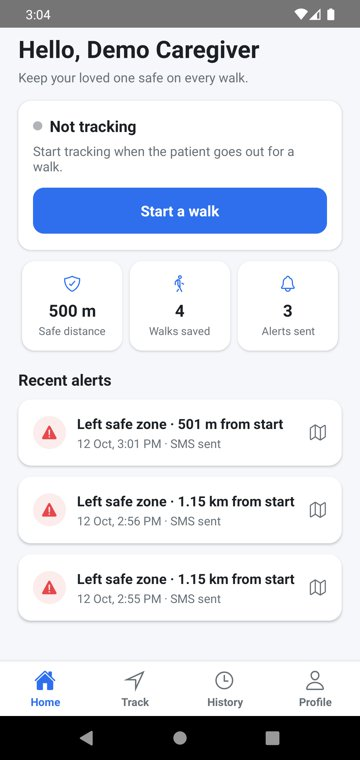
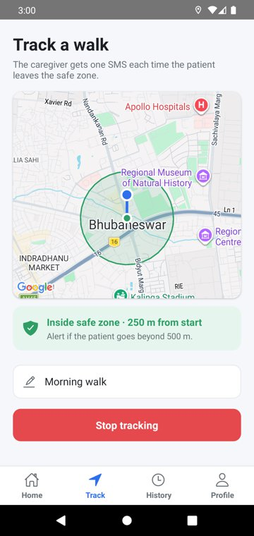
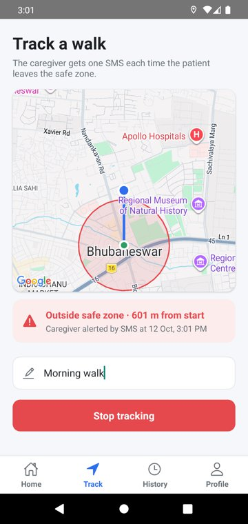
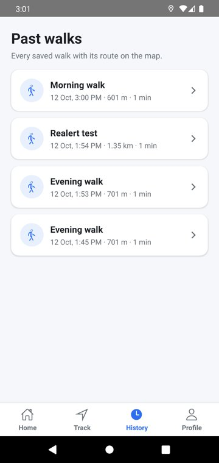
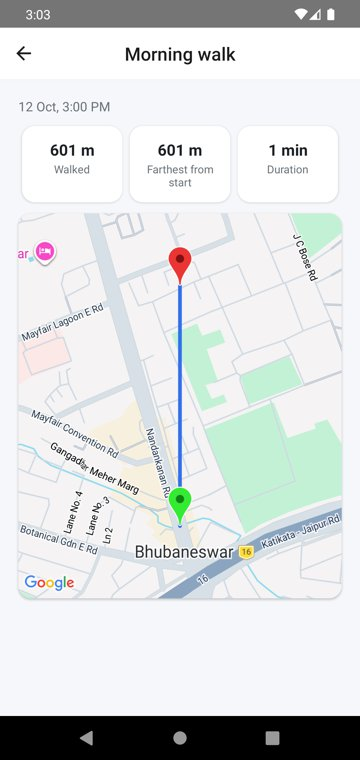
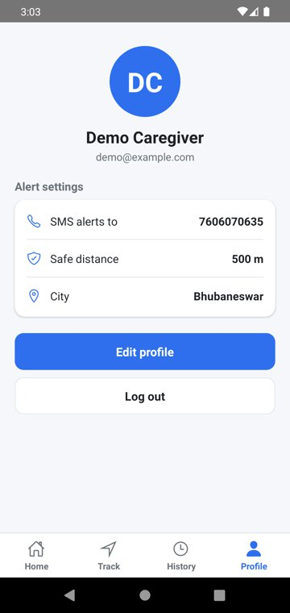
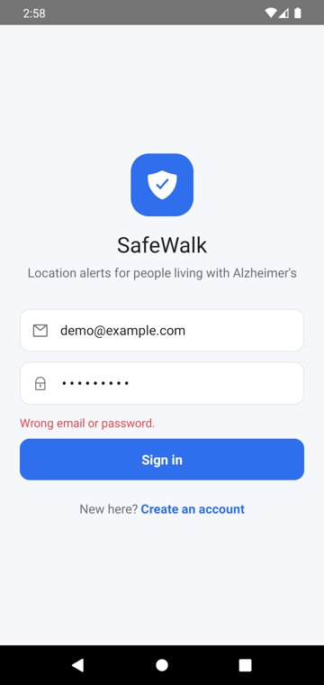
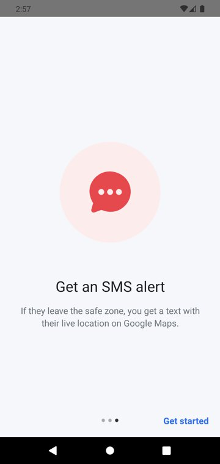

# SafeWalk: Alzheimer's Patient Tracker (React Native app)

Tracks a patient's walk on a map and sends the caregiver an SMS with a live Google Maps link when the patient walks outside a safe zone.

Backend: [AlzeimerBackend](https://github.com/Chinmaya2310/AlzeimerBackend) (Node.js, Express, MongoDB).

Originally built in 2021 as a team project with [Abhinav Anand](https://github.com/abhinavanand500). Revived, fixed and redesigned in 2026.

| Home | Tracking (inside zone) | Alert sent | Past walks |
|---|---|---|---|
|  |  |  |  |

| Walk details | Profile | Sign in | Welcome |
|---|---|---|---|
|  |  |  |  |

## Features
- **Live tracking** of a walk on Google Maps, with the safe zone drawn as a circle around the starting point (green inside, red outside)
- **SMS alert** to the caregiver once per safe-area exit, with a Google Maps link; the app shows when the alert was sent
- **Dashboard** with tracking status, safe distance, walks saved and recent alerts (tap an alert to open its location)
- **Walk history** with distance, duration and the route between start and end pins
- **Profile** with the caregiver's phone number for alerts and an editable safe distance (default 0.5 km)
- Sign up / sign in with JWT; the login persists across app restarts

## Run it (Android emulator)
Requirements: Node 20, Java 11 (Gradle 6.7), Android SDK with an emulator, the backend running on port 3001.

```bash
npm install --legacy-peer-deps
NODE_OPTIONS=--openssl-legacy-provider npx react-native start   # Metro on Node 20
cd android && ./gradlew assembleDebug && adb install -r app/build/outputs/apk/debug/app-debug.apk
adb reverse tcp:8081 tcp:8081
```
The app calls the backend at `http://10.0.2.2:3001` (the host machine as seen from the emulator); change `apis/tracker.js` for a real device.

## Simulate a walk
Sign in, set a safe distance (Account → Edit), start recording on the Record tab, then:
```bash
scripts/simulate-walk.sh 1.2      # walks 1.2 km north in 50 m steps
```
or use the emulator's Extended controls → Location → Routes.

## 2026 fixes and redesign
- Redesigned every screen: dashboard, safe-zone map and alert banner, walk history and details, profile, onboarding, sign-in and sign-up
- Alert sent on every re-render (SMS spam) → once per safe-area exit, using the caregiver's saved distance
- Track details / Edit Profile unreachable after login, logout not working → logged-in navigator + login restored once at startup
- Buttons needing two taps while the keyboard is open; Edit Profile inputs refilling old values; sign-up ignoring "Confirm Password"
- Build: Fresco pinned to 2.3.0 (2.2.0 only existed on the shut-down JCenter), unused location libraries removed from autolinking
